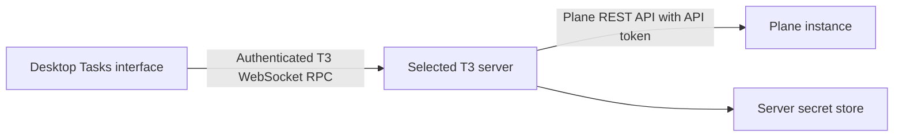

# Plane tasks

The Tasks interface brings task management into the desktop app while Plane remains the source
of truth. Notes are ordinary Plane tasks. Copying a link or task text into a thread is an explicit
user action; opening a task does not start an agent or attach it to a conversation.

This boundary keeps the integration small: T3 owns the connection and the editing experience,
and Plane owns task storage and workflow. There is no second task database to reconcile, offline
write queue, or background synchronization service. See the [user guide](../user/tasks.md) for setup.

## The connection belongs to an environment

The server makes Plane requests through [PlaneService](../../apps/server/src/plane/PlaneService.ts).
Its machine must reach Plane, including through Tailscale when Plane is private. The desktop
client only needs its existing connection to that T3 server. No direct browser request to Plane,
browser CORS configuration, or new Tailscale tunnel is part of this integration.

One Plane connection is configured per environment: instance URL, workspace slug, and API token.
A full workspace URL can supply the slug; an instance root needs an explicit workspace. Signing
into T3 authorizes access to the environment, while the configured token authenticates the server
to Plane using `X-API-Key`. There is no Plane browser login or OAuth flow.

The token uses the existing settings secret lifecycle rather than a separate credential store.
After saving, clients receive a secret marker instead of the stored literal. Leaving the token
field blank preserves it; removing the connection removes its stored secret. Settings changes
need settings write permission. Task reads use `orchestration:read`; task and comment writes use
`tasks:write`, checked on the server as well as in the UI.

Environment selection must survive navigation into settings and back. An explicitly selected
environment going offline must not redirect a write to the local or primary environment. Plane
project IDs are also distinct from T3 project IDs: the Tasks route uses `planeProjectId` to avoid
conflicting with the shared router's existing `projectId` meaning.

## Reads are cached views of Plane

The [shared client state](../../packages/client-runtime/src/state/plane.ts) uses the existing
environment RPC query and command machinery. Queries are scoped by environment and Plane
project/task, so data from different servers is not interchangeable. Successful writes invalidate
the relevant reads; changing the saved connection also invalidates reads from the previous
connection. Cache freshness does not imply a live subscription to edits made elsewhere in Plane.

Browse requests fetch compact task fields, with description HTML loaded only for an opened task.
Tasks and comments load in pages. This avoids carrying every task body across the WebSocket just
to render a list. The Plane adapter follows `next_page_results`, because a `next_cursor` alone
does not prove another page exists.

Search uses Plane's dedicated search endpoint and caps the result set. State, priority, and
assignee filters apply to loaded tasks. These are deliberately different operations: the tested
Plane CE list endpoint silently ignores some search/filter parameters, so sending those parameters
would make the UI promise filtering it had not performed. See the
[API decoding boundary](../../apps/server/src/plane/planeApi.ts) for accepted response shapes.

## Editing must preserve what T3 cannot represent

Plane stores descriptions and comments as HTML. Rendering sanitizes that HTML; editing must also
avoid silently rewriting content that the visual editor cannot preserve. Existing descriptions
with unsupported formatting open as HTML source, and switching to the visual editor requires an
explicit choice with a warning. An untouched description is omitted from the update payload, so
changing priority or an assignee cannot erase richer content. The
[draft helpers](../../apps/web/src/components/planeTasks/planeTaskDraft.ts) and
[HTML boundary](../../apps/web/src/components/planeTasks/planeHtml.ts) encode that distinction.

An editor captures its environment, project, task, and initial values when opened. Refetches do
not replace a draft in progress. Dirty drafts and pending writes block navigation; a disconnect
keeps the editor mounted. These guards protect in-memory work, not a durable draft saved across
app restarts. See [dialog coordination](../../apps/web/src/components/planeTasks/PlaneTaskDialogs.tsx).

Plane writes are direct external API operations, outside T3's event-sourced thread commands and
checkpoint history. T3 cannot roll them back with a thread checkpoint. A timed-out write may
already have succeeded in Plane, so it is not automatically retried; the user must check before
retrying. Failed requests leave the draft available for correction or another attempt.

## Surface and scope

The interface lives in the shared web renderer because Electron wraps that renderer. Desktop
gates cover the Tasks and Plane settings routes and their navigation entries; web and mobile do
not expose task management. The server contract and client state still follow the environment
boundary so remote desktop connections use the same path as local ones.

This integration does not introduce a generic tracker framework, Jira support, automatic agent
actions, task-to-thread linking, or a separate notes system. Adding those would require new
product and ownership decisions rather than treating the current query cache as durable task state.
